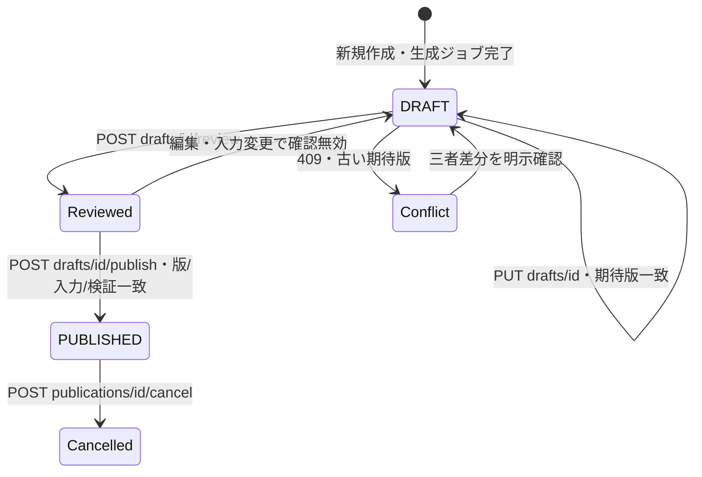
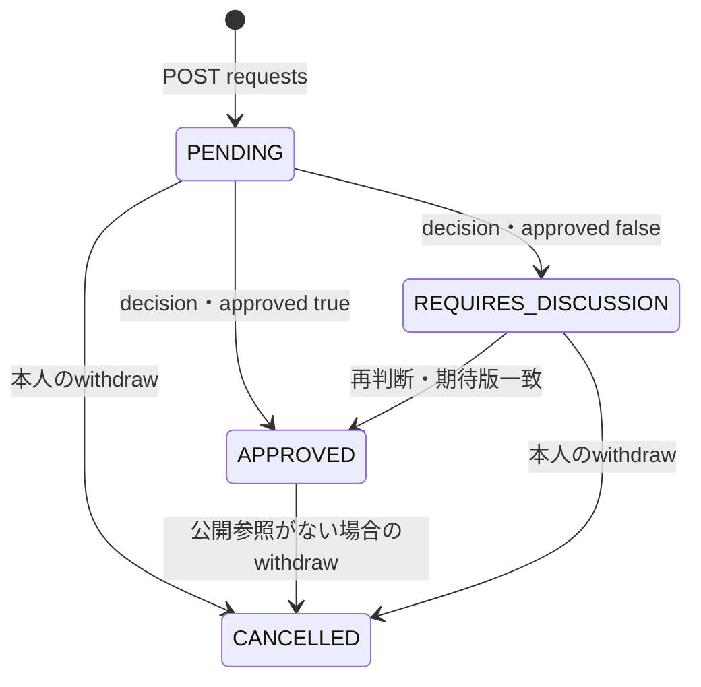
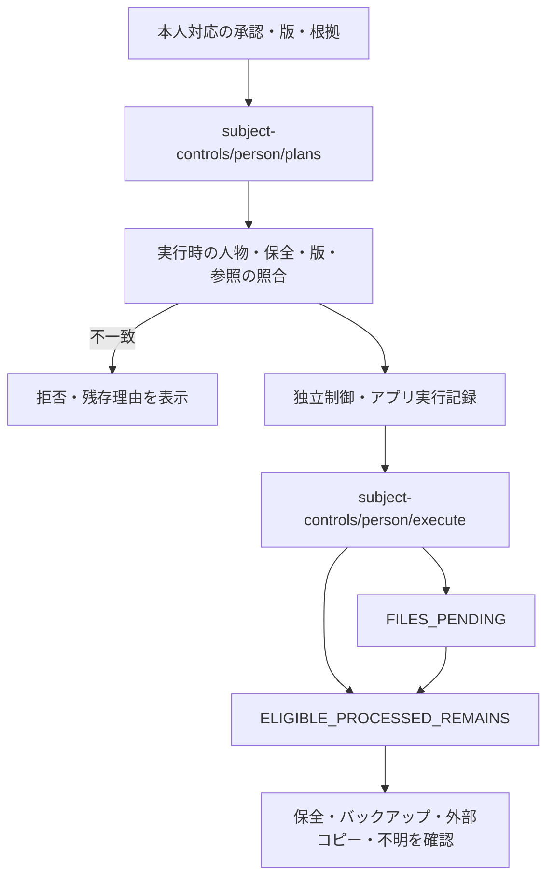
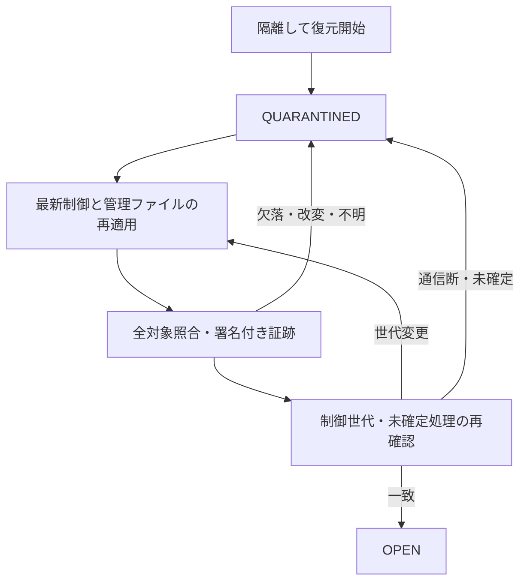
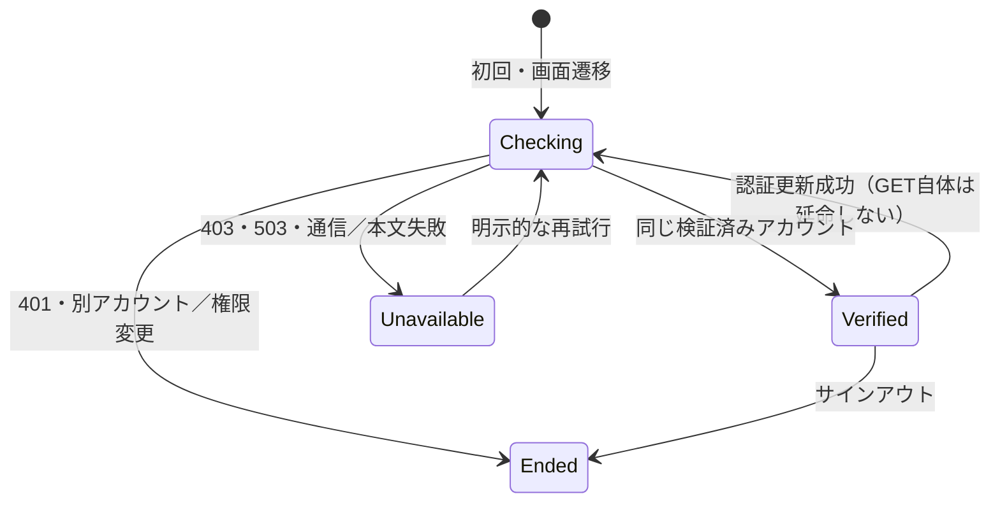

# 業務状態と画面・API・テストの対応

本書は、公開、休暇申請、人物制御、復元の開放及び本人表示の確認について、業務状態と画面、API 及びテストとの対応を記録します。

## 1. 適用範囲

公開資料では、[physical.mmd](physical.mmd) を ORM が宣言する物理構造とし、[logical.md](logical.md) を JSON 内の論理参照として分けています。

隔離した PostgreSQL の読取りによる観測との照合結果は、[検証記録](../../ideal-ui/verification.md)に記載します。当該観測は一つの隔離クラスタを用いるものであり、別ホストへの分離を証明するものではありません。

本書の図は、2026年9月28日の UI/UX 改修に際してソースに基づいて作成した説明図であり、全遷移の形式検証による証明ではありません。

観測時の生ログ及び一時的な図は、公開リポジトリへ収録しません。公開候補と対応する件数、差分及びソースのハッシュだけを、検証記録へ残します。

## 2. 公開と競合

`Reviewed` は画面上の検証状態であり、DB の status の値を増設したものではありません。

画面、API 及び処理の対応は、`PlanningWorkspace.tsx` → `/planning/drafts/*` → `application/planning.py` です。

`tests/test_planning_retry_api.py`、`tests/test_planning_postgres.py`、`frontend/tests/visual/planning-flow.pw.ts` 等の実行結果は、監査台帳（公開範囲外）で照合します。図に記載があることだけをもって、テスト済みとはしません。

## 3. 休暇申請（年休イベント台帳とは別）

公開勤務から参照される申請の変更は、`require_unpublished_request` が拒否します。

画面、API 及び処理の対応は、`PlanningRequests.tsx` → `/planning/requests` → `api/routers/planning.py` です。

予約は、取得の実績ではありません。上の図は申請の表示に限るものであり、年休の義務管理又は付与の訂正の法的な適合を表しません。

## 4. 人物制御と実行可能分の処理

画面、API 及び処理の対応は、`SubjectControlWorkflow.tsx` → `/planning/compliance/subject-controls/*` → `application/subject_controls.py` です。

`CONTROL_APPLIED_REMAINS` は、「全コピーの消去の完了」ではありません。未知の自由記述を、図の矢印だけを根拠に自動で承認しません。

## 5. 復元の開放

`BusinessWorkflow.tsx` の復旧画面は、読取り専用です。実際の復元は、運用 CLI で行います。

図の参照先は、`control/restore_verification.py` 及び `control/service.py` の検証とします。

時点復旧（PITR）、25か月結合の検証、全ての遷移の API 再生並びに目標復旧時点・目標復旧時間（RPO/RTO）について、従来から未達の項目があります。これらの項目の判定は、2026年9月28日の UI/UX 改修のテストでは変更していません。

## 6. 本人表示の確認状態

`Checking` 及び `Unavailable` の間は、業務の入力を保持したまま非表示とし、操作できないようにします。`Ended` では、旧業務を破棄します。

`GET /auth/me` は、署名及び失効を確認済みのアカウント情報を返します。`GET /auth/legacy-context` は、旧来のスコープなしの API のために、単一の所属の職員ID及び実効権限を返します。両者を名前の照合で結び付けません。

ヘッダー及びサイドバーは、IdentityProvider の同じメモリ上の応答を使用します。DB スキーマの変更はありません。

## 7. 改訂履歴

| 日付 | 対象 |
|---|---|
| 2026-09-28 | UI/UX 改修に伴う第1節から第5節までの説明図 |
| 2026-09-29 | 第6節「本人表示の確認状態」 |
