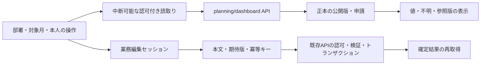
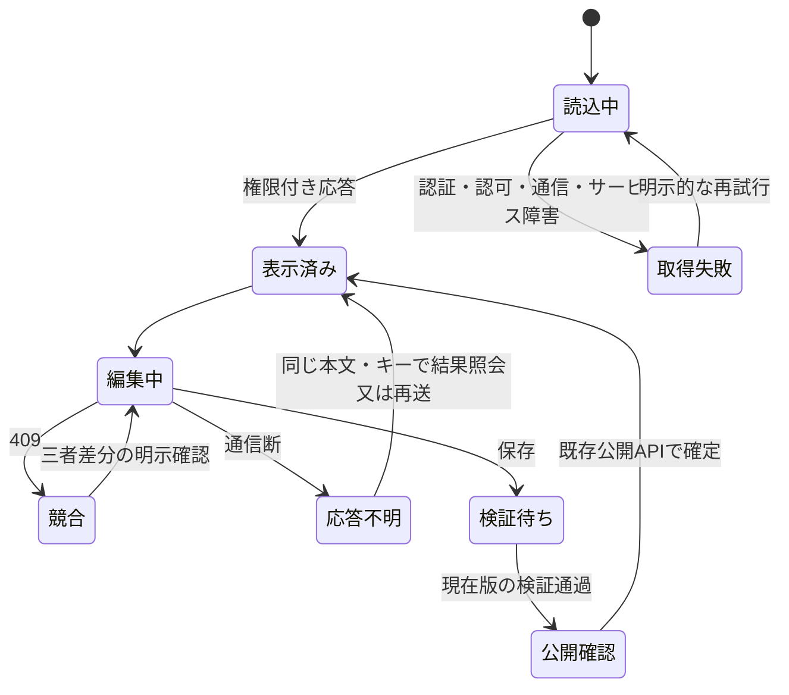
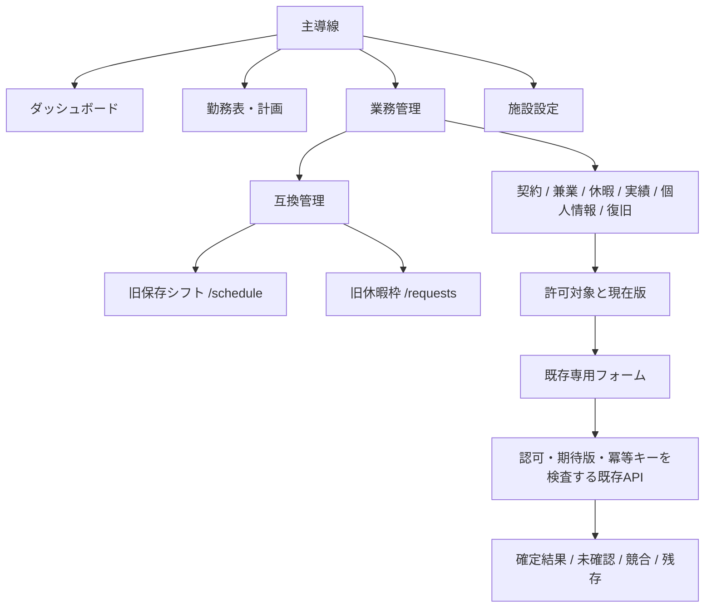

# UI/UXの実装・評価契約

本書は、2026年9月28日及び29日の UI/UX 改修（以下「本改修」という。）について、実装及び評価の契約を定める。

## 1. 目的と責務

情報の読みやすさ及び正確さを優先する。既存の URL、認証並びに生成→確認→公開の流れを維持する。
`components/ui` は視覚部品を、業務画面は入力と表示を、`lib/planningTransport` は編集単位の通信と同一要求の再送を、`lib/planningRead` は中断可能な参照を、`lib/apiTarget` は共通の接続先を、それぞれ担当する。
法的な計算及び公開の判断は、既存のバックエンドの責務である。クライアント側に新しい計算を追加してはならない。

ダッシュボードは、`GET /planning/dashboard?scope_id=…&period=YYYY-MM` を使う。
この API は、既存の publications 及び requests の認可済みの読取りから集計し、`role/visibility/observed_at/sources/metrics` を返す。
`metrics` は、値、available／unknown の別及び理由からなる。取得できない値は null であり、0 ではない。公開期間の件数と本人の勤務件数とを区別する。
稼働率、健康影響及び法令適合率は算定していない。見本データの使用は、Storybook に限る。

## 2. 状態と処理の流れ

消去、復元及び休暇の状態機械は、既存のドメイン実装及び検証記録を正本とする。検証記録は、公開範囲外に保管している。この図だけをもって、全遷移を検証済みとはしない。
ER 図では、ORM の生成物と実際の PostgreSQL の観測とを区別する。アプリ、制御及び世代照合（witness）の図は別々に保存し、サービス間の参照及び JSON 内の参照を物理的な外部キー（FK）に見せない。`devtools.er.physical --database-env <変数名> --label app|control|witness --output <新規場所>` は、読取り専用である。

公開、休暇、消去及び復元の個別の図は、[業務状態の対応](../architecture/er/workflow-states.md)を参照する。

## 3. 採用根拠と反証

| 根拠 | 適用 | 限界 |
|---|---|---|
| DADS（参考文献1） | 16px を基本とし、説明と比較表の密度を分ける | 文字サイズの万人共通の最適値ではない |
| Piepenbrock 2013（参考文献2） | 既定は明るい配色とし、選択肢は保持する | ドイツ語の視力・校正課題である。日本語の勤務編成又は視覚障害全般への直接の証明ではない |
| JAMIA の模擬 EHR 比較（参考文献3） | 関連情報を近くに配置する | 研修医51人の限定された課題である。効果量を本アプリへ移さない |
| WCAG 2.2（参考文献4） | AA を基準とし、一連の業務を評価する | 独自の検査は全適合の証明ではない。ターゲットサイズ等の例外と AAA とを区別する |
| 個人情報保護委員会（PPC）の通則編（参考文献8） | 目的の限定、権限、合成データ、保存の抑止 | 配色又は DB 構造を法律が指定しているわけではない |
| Playwright（参考文献9） | 同一のブラウザ、OS 及びフォントで比較する | 環境差と機能不良とを区別する |

## 4. 受入と利用者評価

既存の操作台帳を基準に、役割×操作×（正常／空／大量／処理中／エラー／409／未保存／再送）を対応付ける。
新しいテストが一部で成功しても、未接続の行を成功に変えてはならない。光学検査の打切り及び判定不能も、未完了として扱う。
画像は1枚ずつ、文字の欠落、主操作、状態の誤認、長文、折返し及びフォーカスを確認する。重要な領域をマスクしてはならない。
API の実通信は、メソッド、パス及び状態だけを記録し、認証情報及び本文を収集しない。静的な経路の推測は、未確認の候補である。

実際の拡大（200%・400%）、キーボードだけでの操作の完結、実機の Safari 及び VoiceOver による確認、並びに実際の職員による評価は、自動検査とは別の受入である。
初回は、3役割について各3人で問題を発見する評価とする。確認のための評価は AB/BA で釣り合わせ、同じ難度の別の課題を使う。
主要な指標は、正しい完了、重大な誤操作及び時間である。予備評価における参加者単位の対数時間差の標準偏差を s とする。
両側5%、検出力80%で10%の短縮を検出するための人数の近似は、`ceil(((1.959964+0.841621)*s/log(0.9))^2)` とする。
人数は最低24人とし、役割ごとに AB/BA が同数になるよう6の倍数へ切り上げる。実施の前に、脱落の見込み及び小標本での近似の妥当性を再確認する。
10%は製品の目標であり、規格又は法的な閾値ではない。反復した課題を独立した参加者として数えず、参加者単位の95%区間を示す。
失敗、中断及び欠測を保持する。重大な誤操作は、修正の対象とする。観測が0件であることは、母集団での危険がゼロであることを意味しない（参考文献15）。
参加者が確保できない場合又は精度が不足する場合は、有用性又は最適性を確定しない。過去の内部評価の記録は個別の作業環境を含むため、公開候補には収録しない。公開用の評価票は、`docs/ideal-ui/evaluation/` に置く。

本改修の UI の結果を、25か月故障、全辺 API、1,200件性能及び施設受入の合格へ流用してはならない。

## 5. セキュリティ照合（ASVS 5.0.0固定）

確認日は、2026年9月28日である。次の表は変更範囲の対応であり、ASVS 全体又は特定のレベルへの適合の認証ではない。

| 要件 | 本改修の実装・検査 | 適用の限界 |
|---|---|---|
| v5.0.0-3.2.2 / 3.4.3（参考文献10） | 表示する文字列は React のテキスト描画。既存の nonce CSP を変更せず、`csp.spec.ts` で確認 | CSP の成功は、全 XSS 経路の証明ではない |
| v5.0.0-3.5.1–3.5.3（参考文献10） | GET dashboard は読取り専用。更新は既存の Origin／JSON／認証の境界を維持 | 新しい代理 API を設けず、Cookie／CSRF の責務を移さない |
| v5.0.0-8.2.1–8.2.3 / 8.3.1（参考文献11） | `access` と既存の本人／部署の読取りを使用。`test_dashboard.py` で越境時の403と本人割当の限定を確認 | ボタンの表示による認可ではない。本番の IdP 及び人事異動は別の受入 |
| v5.0.0-14.2.2 / 14.2.3 / 14.3.2–14.3.3（参考文献12） | no-store、揮発的な編集状態、合成データ、ローカルの画像及び実行台帳 | ブラウザ内の状態保持と永続保存とを区別する。端末での印刷又は外部への持出しの消去証明にはしない |

これらは、技術的な検証の基準である。個人情報保護委員会のガイドラインに基づく利用目的、保存義務及び本人の請求に関する判断を置き換えるものではない。

光学検査のフォーカスの検査は、表示中の対象を列挙し、到達しなかった対象を記録する。閉じた details は対象外とし、開いて操作する状態は別のケースとする。
規格の 2.4.11（AA）（参考文献5）は、完全な遮蔽を禁止する最低限の要件である。部分的な遮蔽を含む AAA 又は 3:1 の独自のリング検査と同一視しない。
2.5.8（参考文献6）の間隔、同等の操作等の例外は、個別に審査する。

## 6. 描画証拠の読み方

2026年9月28日のビルドは macOS の隔離した作業コピーで作成し、3種類のブラウザは固定した Linux のイメージで描画する。
Linux でのクリーンな配布ビルドを実施したとは記載しない。ビルド成果物、配布フォント及び検査ソースは、ハッシュで固定する。
合成 API の観測時刻及びブラウザの時計は、2026-09-28T00:00:00Z に固定する。ただし、業務の法的な計算の時刻及びワーカーの処理時間は変更しない。観測時刻の差替えは、模擬認証（mock）を使う development 環境の隔離 ASGI ファクトリに限り許す。

フォーカスの到達検査は、通常の文書又は表示中の modal dialog／alertdialog を範囲とする。この検査では、一時的な終端要素まで移動できたこと、及び可視の対象で未到達のものがゼロであることを確認する。
モーダルが背景へ Tab を出さないこと自体は、失敗ではない。内部の不正なトラップ、打切り及び対象の漏れは、未完了とする。
終端要素は、検査の後に除去する。Escape、背景の inert 及び開いた要素への復帰は、別の操作テストで確認する。
この補助的な検査は、全キーボード経路又は支援技術の証明ではない。

## 7. 全画面の情報設計（IA）

本改修で追加した `devtools/visual/build.mjs --linux` は、既存の固定イメージで Linux のビルドを作る。
ブラウザも、固定した Linux のイメージで動かす。現行の HTTPS 配信プロセスは macOS の Node であり、全サービスの Linux での稼働とは区別する。
画像比較は、改修前のソースからも同じ Linux のビルドを作った別の系列に限る。

主導線は、`lib/navigation.ts` のダッシュボード／勤務表・計画／業務管理／施設設定である。
旧 `/schedule` 及び `/requests` は URL を保持し、業務一覧の「互換管理」に配置する。
公開勤務と旧保存記録、年休の請求・予約・実取得・義務、並びに人物制御と全コピーの消去を、それぞれ混同しない。

業務ページは、目的・対象 → 選択 → 詳細・根拠 → 許可された操作 → 結果 の順とする。
契約及び実績は、広い幅では一覧と詳細を並べて表示し、狭い幅では同じフォームを縦に表示する。
別画面の実装又は複製した法的な計算を作らない。主要な業務への画面内のリンクはアンマウントせず、三者差分、未保存の値及び冪等キーを保持する。破壊的な操作は、既存の確認及び権限制御を通る。

旧休暇枠はグローバルな役割で判定し、LEADER は参照だけ、ADMIN 及び DEVELOPER は既存 API の更新範囲とする。
業務ページは部署所属の役割で判定し、DEVELOPER を部署の ADMIN へ変換しない。
表示用の Cookie 及びリンクは、認可の証拠ではない。最終的な判定は、API が行う。

操作及びルートの正本は、既存の統合受入（2026年9月23日）の操作台帳である。この操作台帳は検証記録の一部であり、公開範囲外に保管している。
42操作の結果を上書きせず、`screen` 及び `additional_surfaces` の対応を同じ操作台帳へ追加した。
全状態の実行を確認していない行は、`acceptance_pending` のままとする。

### 7.1 根拠と適用範囲

- DADS タイポグラフィ（参考文献1）：本文16px を基本とし、比較表の密度は用途別とする。万人共通の最適値ではない。
- JAMIA 2021（参考文献3）：模擬 EHR における問題別の情報の集約である。勤務表へ効果量を外挿しない。
- PeerJ 2019（参考文献13）：331人の課題で、外観と時間・正確さの改善とは一致しなかった（確認した範囲は著者抄録）。有意差がないことを、効果がないことの証明としない。
- WCAG 2.2（参考文献4）：完全な手続、リフローにおける二次元の表の例外、並びに AA と AAA とを区別する。自動評価の限界（参考文献7）を保持する。
- 個人情報保護委員会の通則編（参考文献8）：利用目的、安全管理及びアクセス制御と照合する。特定の UI を法定の方式としない。
- 厚生労働省の年5日管理の資料（参考文献14）：半日と時間単位の年休の意味を混同しない。UI に法的な計算を再実装しない。

実際の職員による有用性の評価は、未実施である。各役割3人での問題発見と、AB/BA の比較評価とは、別の段階とする。
反復した課題を独立した参加者として数えず、失敗、中断及び欠測を保持する。
最低24人は運用上の下限であり、精度又は検出力を保証する人数ではない。
観測がゼロの誤操作についても、母集団での危険がゼロとはしない（NIST の比率推定、参考文献15）。

### 7.2 本改修の実装の判断と反証

- セクションの切替えには、初期状態では文書内のリンクを採用した。フォームを非表示にし、又は再生成するタブを増やすと、未保存の値や再送のキーを失う可能性があるため、既存の編集セッションを維持する。スクロールの距離が最適であるかは、未評価である。
- 明示された別部署へのリンクは、現在の部署で上書きしない。部署及び期間は表示の文脈であり、許可の根拠ではない。操作の範囲は、API から返る所属及び権限が決める。
- 旧休暇枠は、現行の年休の計算から分離する。取得の失敗時及び読込みの途中には、残数ゼロを示さない。応答の順序が逆になっても、以前の月の値を現在の月に表示しない。
- 密な比較表は必要な最小幅を維持し、説明付きの、キーボードで操作できる横スクロール領域にする。WCAG の二次元の表の例外は、狭い幅で見出しを一文字ずつ改行することを推奨する根拠ではない。
- 画像の重なり検査が成功しても、説明内容の誤り及び関連情報の離隔は検出できない。本改修でそれらが独立したレビューで見つかった事実を、自動検査の限界として記録する。

## 8. 本人・権限・状態の意味契約

本人欄は、`GET /auth/me` の表示名及び識別子を使用する。local の識別子は「ログインID」、OIDC のアプリ内識別子は「アカウントID」とする。表示名が欠損している場合は「表示名未登録」とし、権限名又は認証状態を名前として補完しない。display Cookie は、表示及び認可の正本にしない。

全体の権限、部署所属の権限及び本人との関係は、別の概念である。部署の ADMIN は「部署管理者」、LEADER は「部署責任者」、STAFF／PHARMACIST は「部署職員」とする。
旧来のスコープなしの API に限り、`/auth/legacy-context` が単一の所属を person_id／effective_role へ対応付ける。複数の所属は、従来どおり拒否する。この拒否を、アカウントの本人確認の失敗として表示しない。

本人確認の読取りは、セッションを更新しない。確認中及び確認不能の間は、業務内容を保持したまま非表示とし、操作できないようにする。認証の終了又はアカウントの変更では、旧業務を破棄する。署名、失効及び制御サービスの検査は、API 側に残す。

年休取得義務の `fulfilled`、`overdue` 及び `at_risk` は、API の結果を翻訳するだけとし、未知の値を正常又は不足見込みへ補完しない。期間、半日単位からの日数表示及び付与主体は、別の項目として保持する。

既存の操作台帳の `semantic_audit` は、概念、正本、対象、時点版、単位、状態、許可操作及びテストを照合するための欄である。本人表示の成功を、その操作の全業務意味の受入へ読み替えない。

年間区分期間の同意は、状態、資料名、確認責任者及び時差付きの期限を別々の入力にする。文字列の区切り又は空白を正規化して、証拠の本文を変更しない。日数及び時間量は整数で保持し、三者差分には各期間の資料と期限まで表示する。UI の構造検査は、法的な公開可否の再計算ではない。

## 9. 参考文献

1. デジタル庁『デジタル庁デザインシステム（DADS）タイポグラフィ』（https://design.digital.go.jp/dads/foundations/typography/）
2. Piepenbrock ほか（2013）（https://www.psychologie.hhu.de/fileadmin/redaktion/Oeffentliche_Medien/Fakultaeten/Mathematisch-Naturwissenschaftliche_Fakultaet/Psychologie/AAP/Publikationen/2013/Piepenbrock-2013-Positive_display_polarity_is_.pdf）
3. JAMIA 掲載の模擬 EHR 比較（2021）（https://pubmed.ncbi.nlm.nih.gov/33566093/）
4. W3C『Web Content Accessibility Guidelines (WCAG) 2.2』（https://www.w3.org/TR/WCAG22/）
5. W3C WAI『Understanding Success Criterion 2.4.11: Focus Not Obscured (Minimum)』（https://www.w3.org/WAI/WCAG22/Understanding/focus-not-obscured-minimum.html）
6. W3C WAI『Understanding Success Criterion 2.5.8: Target Size (Minimum)』（https://www.w3.org/WAI/WCAG22/Understanding/target-size-minimum.html）
7. W3C WAI『Selecting Web Accessibility Evaluation Tools』（https://www.w3.org/WAI/test-evaluate/tools/selecting/）
8. 個人情報保護委員会『個人情報の保護に関する法律についてのガイドライン（通則編）』（https://www.ppc.go.jp/personalinfo/legal/guidelines_tsusoku/）
9. Playwright『Visual comparisons』（https://playwright.dev/docs/test-snapshots）
10. OWASP『ASVS 5.0.0 V3 Web Frontend Security』（https://raw.githubusercontent.com/OWASP/ASVS/v5.0.0/5.0/en/0x12-V3-Web-Frontend-Security.md）
11. OWASP『ASVS 5.0.0 V8 Authorization』（https://raw.githubusercontent.com/OWASP/ASVS/v5.0.0/5.0/en/0x17-V8-Authorization.md）
12. OWASP『ASVS 5.0.0 V14 Data Protection』（https://raw.githubusercontent.com/OWASP/ASVS/v5.0.0/5.0/en/0x23-V14-Data-Protection.md）
13. PeerJ 掲載論文（2019）（https://pubmed.ncbi.nlm.nih.gov/30809464/）
14. 厚生労働省 年5日の年次有給休暇の管理に関する資料（https://www.mhlw.go.jp/content/001140963.pdf）
15. NIST/SEMATECH『e-Handbook of Statistical Methods』比率の推定（https://www.itl.nist.gov/div898/handbook/prc/section2/prc241.htm）

## 10. 改訂履歴

| 日付 | 対象 |
|---|---|
| 2026-09-28 | 第1節から第6節まで（題名に付した日付）、第5節の確認日 |
| 2026-09-29 | 第7節「全画面の情報設計（IA）」、第8節「本人・権限・状態の意味契約」 |
